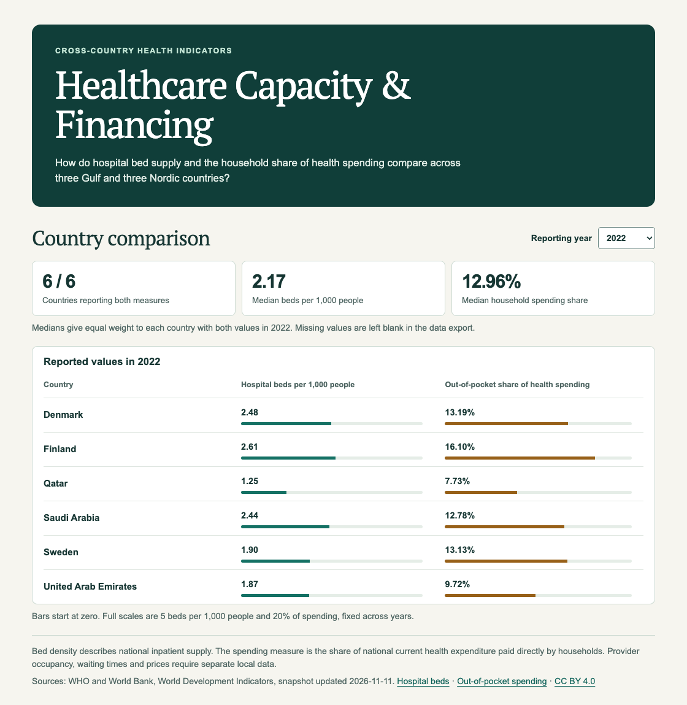

# Healthcare Capacity & Financing

A provider partnerships team wants to compare hospital bed supply and the share of health spending paid directly by households across the UAE, Sweden and four peers. Which reporting year gives the team a fair starting point, and what information still needs to come from hospitals?

**In the 2014–2023 study window, use 2022 for the six-country comparison.** All six countries reported both measures that year. Only Denmark and Saudi Arabia reported both in 2023. In 2022, the UAE and Sweden had similar bed density (1.87 and 1.90 per 1,000 people) while their household spending shares differed by 3.41 percentage points (9.72% and 13.13%). For an actual referral decision, ask the provider about staffed beds, waiting times and the price of the specific procedure.

[Read the provider brief](reports/provider-brief.md) · [Download the Excel workbook](reports/healthcare-comparison.xlsx) · [Download the offline dashboard](https://github.com/boostx1/healthcare-access-analysis/raw/refs/heads/main/docs/index.html) · [Inspect the country-year data](reports/country_year.csv)



## Reproduce the analysis

Requires Python 3.9 or later with its standard SQLite module. Clone or download the repository and run the commands below in its root. Both use the included snapshots and work offline.

```sh
python3 analyze.py
python3 -m unittest -v
```

Open [docs/index.html](docs/index.html) locally and select a reporting year. The dashboard uses one HTML file with embedded charts and data. It gives every country with both observations equal weight when calculating each median. The separate [Excel workbook](reports/healthcare-comparison.xlsx) includes the 2014–2023 snapshot, native formulas and a coverage chart. Its Data sheet explains how to refresh the values from the [CSV export](reports/country_year.csv). The Python build produces the CSV and HTML outputs independently of Excel. [Quality checks](reports/quality.json) list every missing observation, yearly coverage and the latest complete year.

The build also creates `build/healthcare.sqlite`. With the SQLite CLI installed, this query shows which comparisons have complete coverage.

```sh
sqlite3 -header -column build/healthcare.sqlite 'SELECT * FROM annual_coverage ORDER BY year;'
```

## Data and methods

The panel covers 2014–2023. The UAE, Qatar and Saudi Arabia form the Gulf group. Sweden, Denmark and Finland form the Nordic group. The countries were selected for a small, illustrative comparison anchored on the UAE and Sweden. The results describe these six countries only.

1. **Check the inputs.** Verify both source files against the SHA-256 hashes in the manifest. Check the JSON response count, indicator codes, ISO3 country identifiers and country labels.
2. **Reshape and validate.** Read hospital beds from the country-year JSON feed and unpivot the annual financing columns from the wide CSV. Parse numbers, retain missing values and check plausible ranges. The SQLite schema enforces foreign keys and one observation per country, year and indicator. [Input manifest](data/sources.json) · [Relational schema](sql/schema.sql)
3. **Join on the same year.** Construct the 60 country-year combinations first, then left-join each measure. Six bed-density observations are missing across the full window, leaving 54 complete pairs. Source nulls remain null. The analysis uses neither interpolation nor carrying a value forward. [SQL views](sql/analysis.sql)
4. **Summarize.** Select the most recent year in which all six countries report both measures. For annual dashboard medians, use the same complete cases for both metrics. Compare endpoints using the earliest and latest complete years. Spending-share differences are expressed in percentage points. [Provider brief](reports/provider-brief.md)

## Scope and sources

Bed supply measures national inpatient beds relative to population. It cannot identify local vacancies, staffing or treatment capacity for a specific service. The household share measures how national health expenditure is financed. It cannot estimate a patient's bill or the price of a procedure. National aggregates contain no patient records. They support discussion with providers rather than clinical, financial or quality rankings.

WHO supplies the hospital-bed series, supplemented by country data, and the Global Health Expenditure Database supplies the financing series. The World Bank distributes both via World Development Indicators under CC BY 4.0. The files reflect the source update of 11 November 2026 and were retrieved on 24 November 2026. The financing file contains an attributed extract of six rows and ten years from the larger source archive. [Hospital beds](https://data.worldbank.org/indicator/SH.MED.BEDS.ZS) · [Out-of-pocket share](https://data.worldbank.org/indicator/SH.XPD.OOPC.CH.ZS) · [Data licence](https://creativecommons.org/licenses/by/4.0/) · [World Bank data terms](https://datacatalog.worldbank.org/public-licenses)

This is an AI-assisted portfolio case study. Its findings are an independent analysis of the public data.
